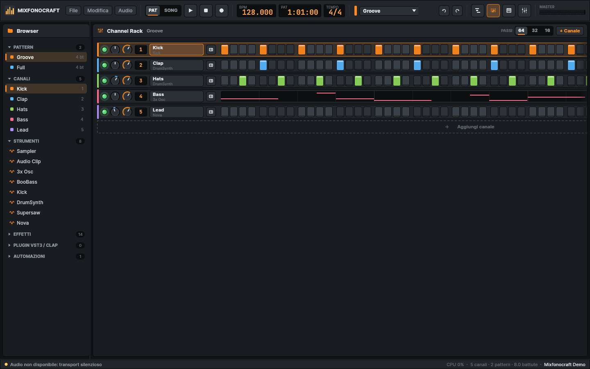
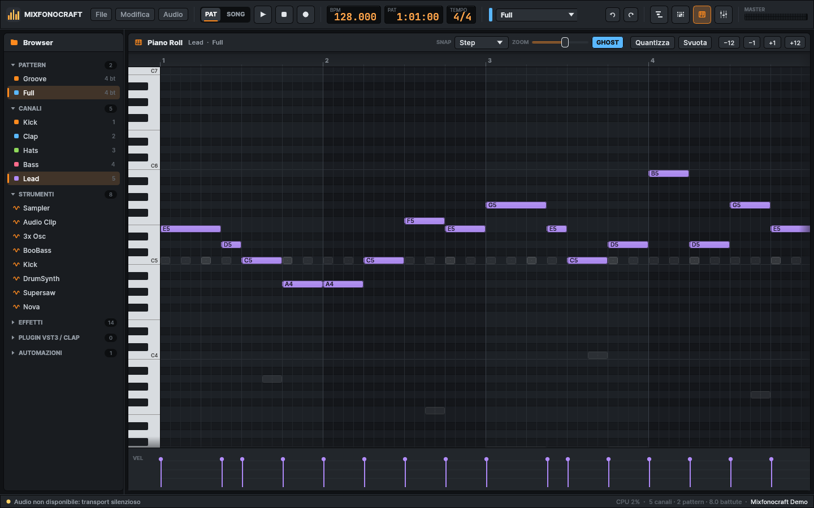
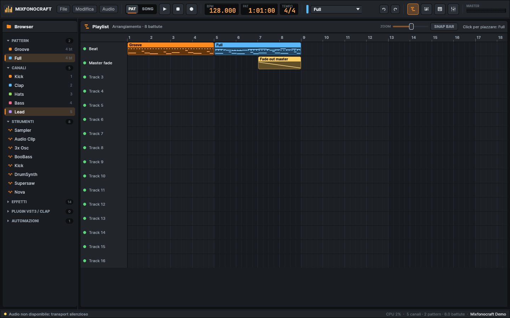
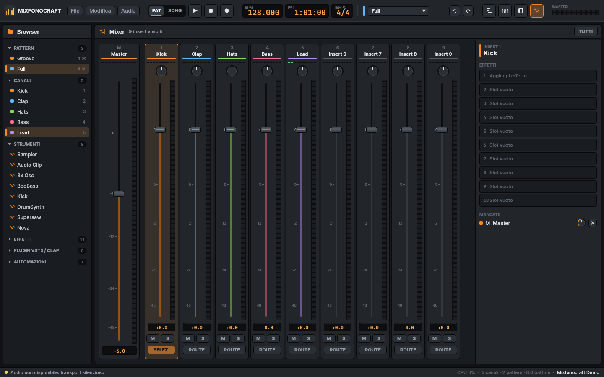
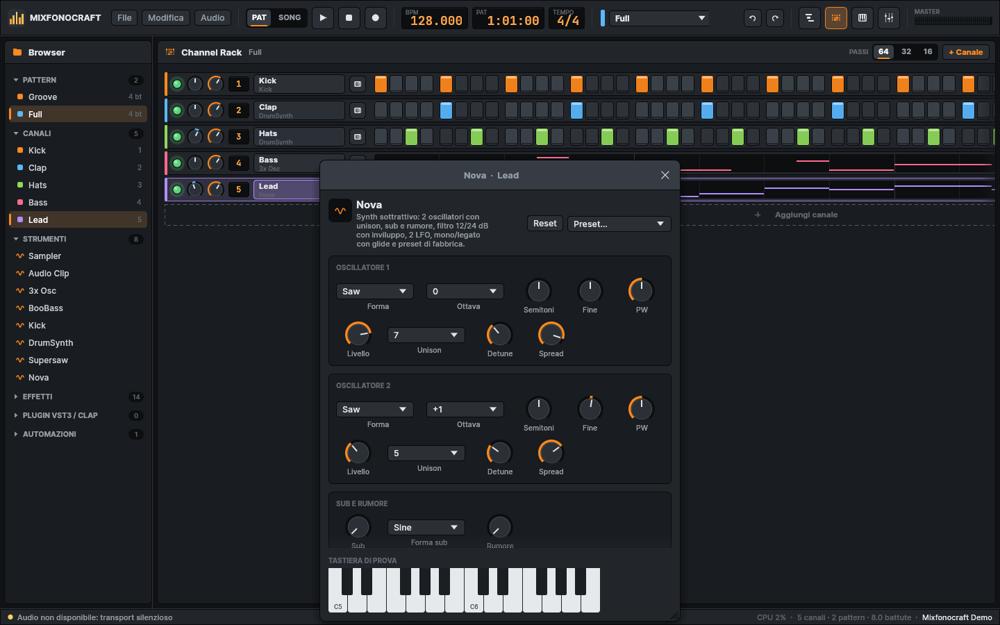

# Mixfonocraft AI Studio

Mixfonocraft AI Studio è una DAW (Digital Audio Workstation) scritta in Rust, ispirata al
flusso di lavoro di FL Studio: Channel Rack con step sequencer, piano roll, Playlist, mixer a
125 insert con effetti e mandate, automazioni e interoperabilità con i file `.flp`. Un server
[MCP](https://modelcontextprotocol.io) permette a un agente AI di comporre e mixare un brano
usando gli stessi comandi della GUI.

Il progetto è una ricostruzione **clean-room**: il codice è scritto da zero e non deriva da
software Image-Line. Il formato `.flp` è stato mappato solo da documentazione pubblica della
community (PyFLP, Monad.FLParser e note sul formato), senza decompilazione. Mixfonocraft non è
affiliato né approvato da Image-Line; FL Studio è un marchio dei rispettivi titolari.



| Piano Roll | Playlist |
|---|---|
|  |  |
| **Mixer** | **Editor plugin** |
|  |  |

> Gli screenshot sono generati senza GPU dal rasterizzatore software incluso:
> `cargo run -p mfc-gui --release --features snapshot --example screenshot -- examples/demo.mfc docs/screenshots`

## Funzionalità

- **Channel Rack** con generatori nativi, canali sampler e audio clip, layer, pitch, pan e
  nota radice per canale.
- **Step sequencer** a 1/16 e **piano roll** con quantizzazione, trasposizione e velocity.
- **Playlist** su 500 tracce con clip di pattern, audio e automazione, ripetizioni e mute.
- **Mixer** con master e 125 insert, 10 slot effetto per insert, mandate, mute, solo, fase e
  scambio L/R, con 23 plugin nativi (9 generatori, 14 effetti).
- **Automazioni** su volume, pan, pitch, tempo, parametri di canale ed effetti, con curve a tensione.
- **Transport** in modalità Song o Pattern, con swing globale.
- **Render** offline in WAV (16 o 24 bit intero, 32 bit float), con normalizzazione e stem per insert.
- **Formati**: progetti nativi `.mfc` (JSON), import ed export `.flp`, import ed export MIDI (`.mid`).
- **Undo/redo** su ogni modifica, condiviso da GUI, CLI e server MCP.
- **CLI** `mixfonocraft` per convertire, ispezionare e renderizzare progetti, con un brano dimostrativo.
- **Nova**, synth sottrattivo polifonico: due oscillatori con unison fino a 8 voci, sub e rumore,
  filtro 12/24 dB con inviluppo, due LFO, modalità mono/legato con glide e 16 preset di fabbrica
  (lead, bassi, pad, pluck, keys, FX).
- **Plugin VST3 e CLAP**: scansione delle cartelle standard, strumenti ed effetti caricati
  nell'app, interfaccia originale del plugin in una finestra nativa (macOS e Windows), editor
  generico dei parametri, stato salvato nel progetto.
- **Ingresso live**: tastiera del computer come pianoforte, tastiere MIDI hardware,
  registrazione delle note nel pattern durante la riproduzione.
- **Impostazioni audio**: dispositivo di uscita, frequenza di campionamento, buffer e carico CPU.
- **Dialoghi file nativi** e **drag & drop** di progetti, MIDI, campioni WAV e plugin.
- **Server MCP** con 47 tool per creare progetti, pattern, mix e render da un agente AI.

## Struttura del workspace

| Crate | Ruolo |
|---|---|
| `mfc-core` | Modello del progetto, `Command` con undo/redo, tempo (PPQ, tick) |
| `mfc-dsp` | Primitive DSP real-time safe: oscillatori, filtri, inviluppi, delay, LFO |
| `mfc-plugins` | Generatori ed effetti nativi, descrittori dei parametri e registro |
| `mfc-engine` | Motore audio: sequencer sample-accurate, mixer, automazioni, render offline, backend |
| `mfc-flp` | Lettura e scrittura dei file FL Studio (`.flp`) |
| `mfc-midi` | Import ed export MIDI standard (SMF 0 e 1) |
| `mfc-mcp` | Server MCP su stdio e catalogo dei tool |
| `mfc-host` | Hosting di plugin VST3 e CLAP: scansione, istanze, parametri, stato, editor nativi |
| `mfc-gui` | Interfaccia grafica egui: Browser, Channel Rack, Piano Roll, Playlist, Mixer, editor plugin |
| `mfc-cli` | Binario `mixfonocraft`: CLI, server MCP e GUI |

Per il dettaglio di dipendenze, modello dati e motore vedere [`docs/ARCHITECTURE.md`](docs/ARCHITECTURE.md).

## Download (macOS e Windows)

I pacchetti pronti vengono generati dal workflow [`release.yml`](.github/workflows/release.yml)
e allegati alle [GitHub Release](../../releases) a ogni tag `v*` (per le pull request sono
disponibili come artifact della run):

| Piattaforma | File da scaricare |
|---|---|
| macOS Apple Silicon (M1/M2/M3/M4) | `Mixfonocraft-<ver>-macos-arm64.dmg` |
| macOS Intel | `Mixfonocraft-<ver>-macos-x86_64.dmg` |
| Windows 10/11 x64, installer | `Mixfonocraft-<ver>-windows-x86_64-setup.exe` |
| Windows 10/11 x64, MSI (per tutto il computer) | `Mixfonocraft-<ver>-windows-x86_64.msi` |
| Windows 10/11 x64, portatile (senza installazione) | `Mixfonocraft-<ver>-windows-x86_64-portable.zip` |

Ogni pacchetto contiene l'app Mixfonocraft AI Studio (doppio click = GUI, senza finestra console)
e l'eseguibile `mixfonocraft` per CLI e server MCP. L'audio realtime è attivo (CoreAudio / WASAPI).

**macOS**

1. Apri il `.dmg` e trascina **Mixfonocraft AI Studio** nella cartella **Applicazioni**.
2. Al primo avvio: l'app è firmata solo ad-hoc (nessun certificato Apple Developer), quindi
   Gatekeeper la blocca. Apri la cartella Applicazioni, fai click destro su *Mixfonocraft* →
   *Apri* → *Apri*. In alternativa, da terminale:
   `xattr -dr com.apple.quarantine /Applications/Mixfonocraft.app`

**Windows**

- **Setup.exe**: doppio click e segui la procedura. Puoi scegliere l'installazione per il solo
  utente o per tutto il computer, e se aggiungere la CLI al PATH e creare l'icona sul desktop.
  I file `.mfc` si aprono con Mixfonocraft AI Studio.
- **MSI**: installa in `Program Files` per tutto il computer (per l'installazione per utente usa Setup.exe).
- **Portatile**: estrai lo zip ed esegui `mixfonocraft-studio.exe`.
- SmartScreen può mostrare "PC protetto da Windows" → *Ulteriori informazioni* →
  *Esegui comunque* (il software non è firmato con certificato di codice).

**CLI e server MCP**

- macOS: `/Applications/Mixfonocraft.app/Contents/MacOS/mixfonocraft mcp --workdir /percorso/progetti`
- Windows: `mixfonocraft.exe` nella cartella di installazione (`C:\Program Files\Mixfonocraft AI Studio\`
  per l'MSI e per Setup.exe con installazione per tutto il computer,
  `%LOCALAPPDATA%\Programs\Mixfonocraft AI Studio\` per l'installazione per utente).
  Se nel PATH, basta `mixfonocraft` da terminale. Anche `mixfonocraft gui` apre la GUI.

Per pubblicare una nuova versione: aggiornare `version` in `Cargo.toml`, poi
`git tag v0.1.0 && git push origin v0.1.0`, oppure avviare manualmente il workflow *Release* (Actions → Release → Run workflow) indicando il tag.

## Compilazione

Serve un toolchain Rust recente (il workspace dichiara `rust-version = 1.80`).

```sh
cargo build --release -p mfc-cli
# binario: target/release/mixfonocraft
```

Feature di `mfc-cli`:

| Feature | Default | Effetto |
|---|---|---|
| `gui` | sì | Include la GUI (`mixfonocraft gui`) e le sue dipendenze grafiche |
| `realtime` | no | Uscita audio sulla scheda tramite `cpal`, per il transport live |

Su **Linux** la feature `realtime` richiede le librerie di sviluppo ALSA:

```sh
# Debian / Ubuntu
sudo apt install libasound2-dev
cargo build --release -p mfc-cli --features realtime
```

La feature `gui` usa eframe con backend OpenGL e supporto X11 e Wayland: serve un
driver grafico con OpenGL disponibile. Per una build senza interfaccia grafica, utile sui
server e per il solo server MCP:

```sh
cargo build --release -p mfc-cli --no-default-features
```

## Avvio rapido (CLI)

```sh
# Brano dimostrativo in A minor a 128 BPM, con render WAV
mixfonocraft demo demo.mfc --render demo.wav

# Riepilogo: tempo, canali, pattern, Playlist, mixer
mixfonocraft info demo.mfc
mixfonocraft info demo.mfc --json

# Conversione tra formati (.mfc, .flp, .mid)
mixfonocraft convert demo.mfc demo.flp
mixfonocraft convert demo.flp demo-da-flp.mfc

# Render del brano, di un pattern, con stem per insert
mixfonocraft render demo.mfc brano.wav --stems --format int16
mixfonocraft render demo.mfc groove.wav --pattern 1 --loops 4

# Ispezione degli eventi grezzi di un .flp
mixfonocraft flp-inspect progetto.flp --id 67 --limit 20

# Catalogo dei plugin con i parametri
mixfonocraft plugins
```

Nel repository c'è già un progetto dimostrativo in `examples/demo.mfc`.

Tutti i comandi: `mixfonocraft --help` e `mixfonocraft <comando> --help`.

## GUI

```sh
mixfonocraft gui [progetto.mfc]
```

Scorciatoie, in stile FL Studio:

| Tasto | Azione |
|---|---|
| `F5` | Playlist |
| `F6` | Channel Rack |
| `F7` | Piano Roll |
| `F9` | Mixer |
| `Spazio` | Play / stop |
| `L` | Alterna modalità Song e Pattern |
| `Ctrl+Z` | Annulla (`Cmd` su macOS) |
| `Ctrl+Y` | Ripristina |
| `Ctrl+S` | Salva (chiede il nome se il progetto non ha ancora un file) |
| `Ctrl+Shift+S` | Salva con nome |
| `Ctrl+O` | Apri |
| `Ctrl+R` | Registra le note live nel pattern |
| `Z`…`M`, `Q`…`P` | Tastiera del computer come pianoforte (due ottave, layout FL) |
| `Shift+↑/↓` | Ottava della tastiera del computer |

### Synth Nova

Nel Browser, sezione **Strumenti**, un clic su **Nova** aggiunge un canale con il synth. Nell'editor
del plugin il menu **Preset…** carica uno dei 16 suoni di fabbrica, poi ogni controllo è modificabile:
oscillatori, sub e rumore, filtro, inviluppi, LFO e modalità di voce. Per ascoltare tutti i preset:

```sh
cargo run -p mfc-plugins --release --example nova_presets -- nova.wav
```

Dal server MCP: `channel_add` con `"plugin": "mfc.nova"` e `"preset": "Acid Bass"`.

### Plugin VST3 e CLAP

Nel Browser, sezione **Plugin VST3 / CLAP**, premere **Scansiona** per cercare i plugin nelle
cartelle standard del sistema, oppure trascinare un file `.vst3` o `.clap` sulla finestra. Un clic
su uno strumento crea un canale, un clic su un effetto lo aggiunge all'insert selezionato. Nell'editor
del plugin, **Apri interfaccia** mostra la GUI originale; i parametri sono anche modificabili e
automatizzabili dall'editor generico. Lo stato del plugin viene salvato nel progetto `.mfc`.

Il menu **Audio** contiene le impostazioni dell'uscita, la scelta dell'ingresso MIDI e l'opzione
per usare la tastiera del computer come pianoforte.

## Server MCP

Il server parla JSON-RPC 2.0 su stdin/stdout. I percorsi relativi dei tool vengono risolti
rispetto alla cartella indicata con `--workdir`.

Claude Code:

```sh
claude mcp add mixfonocraft -- /percorso/a/mixfonocraft mcp --workdir /percorso/progetti
```

Claude Desktop, in `claude_desktop_config.json`:

```json
{
  "mcpServers": {
    "mixfonocraft": {
      "command": "/percorso/a/mixfonocraft",
      "args": ["mcp", "--workdir", "/percorso/progetti"]
    }
  }
}
```

Protocollo, catalogo dei 47 tool, unità di misura ed esempio di sessione completa sono in
[`docs/MCP.md`](docs/MCP.md). Una sessione pronta da eseguire è in
`examples/mcp/beat_session.jsonl`.

## Test

```sh
cargo test -p mfc-cli                 # CLI: demo, render, conversioni, binario, server MCP
cargo test --workspace                # tutti i crate
cargo clippy -p mfc-cli --all-targets -- -D warnings
cargo fmt --all -- --check
```

I test di `mfc-cli` (`crates/mfc-cli/tests/cli.rs`) costruiscono il brano dimostrativo in
memoria, ne verificano struttura e render (durata, livello, dissolvenza), fanno il giro
`.mfc` → `.flp` → `.mfc` e `.mid`, eseguono il binario e dialogano con il server MCP via stdio.

## Documentazione

- [`docs/ARCHITECTURE.md`](docs/ARCHITECTURE.md): crate, modello dati, tempo, undo, motore audio, plugin, render, threading.
- [`docs/MCP.md`](docs/MCP.md): protocollo, tool, unità di misura, sessione di esempio.
- [`docs/FLP_FORMAT.md`](docs/FLP_FORMAT.md): mappatura del formato FL Studio.

## Limiti attuali

- Plugin VST3/CLAP: su Linux l'interfaccia originale non è disponibile (si usa l'editor generico);
  i plugin VST2 e AU non sono supportati; i plugin esterni non vengono esportati nel `.flp`.
- Le modifiche ai parametri fatte nell'interfaccia originale del plugin vengono salvate nello stato
  del plugin, ma non generano automazioni.
- L'esportazione `.flp` non è stata verificata con FL Studio reale. I test coprono il round-trip
  interno e la struttura del file.
- Le clip di automazione non vengono esportate nel `.flp`.
- I plugin FL sconosciuti vengono conservati come dati opachi e riesportati senza modifiche, ma
  non suonano.
- I plugin nativi senza equivalente in FL Studio (drum synth, supersaw) diventano canali sampler
  vuoti con lo stesso nome nel `.flp`.
- L'audio realtime dipende dal backend della piattaforma; senza scheda audio il transport gira
  senza uscita.

## Licenza

Distribuito con licenza `MIT OR Apache-2.0`, come dichiarato nel `Cargo.toml` del workspace.
